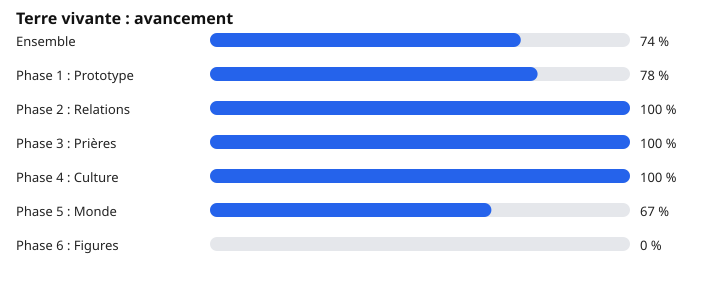

# Terre vivante : avancement

Mis à jour à chaque tour de travail. Une tâche n'est cochée que si elle est vérifiée (tests ou démonstration). Pour recalculer la barre : `python3 avancement.py`.

## Avancement global : 74 %

Calcul : moyenne des pourcentages des six phases. Phase 1 à 78 %, phases 2 à 6 non commencées.

## Phase 1 : Prototype (78 %)

- [x] Île générée depuis une graine, toujours la même pour une graine donnée
- [x] Personnes avec faim, énergie et âge
- [x] Déplacements vers la nourriture et exploration au hasard
- [x] Nourriture qui repousse, plafonnée au maximum
- [x] Mort de faim et de vieillesse
- [x] Tests automatiques (7 tests, tous passent)
- [x] Démonstration en ligne de commande (`python3 run_demo.py`)
- [ ] Critère de réussite : le groupe survit une année simulée avec le réglage par défaut. **Non atteint** : 5 morts sur 20 avec 12 buissons. Le test passe avec 60 buissons seulement.
- [ ] Visualisation sur téléphone : reportée à Godot, après validation de la simulation

Écart avec le document de conception : l'île est générée et non tirée d'une carte réelle. La carte réelle relève de la phase 5.

## Phase 2 : Relations (100 %)

- [x] Communication entre personnes (face à face, rencontres entre voisins)
- [x] Rumeurs qui se déforment en passant de bouche en bouche (fiabilité qui baisse à chaque passage)
- [x] Mémoire des événements avec oubli progressif
- [x] Relations de confiance et d'affection
- [x] Mariages et familles (mariage entre adultes, naissances entre conjoints)

Constat initial : sur une année, aucun couple ne se forme, car les rencontres sont rares. Avec le joueur de démonstration (phase 3), deux couples se forment. La fréquence reste à équilibrer.

## Phase 3 : Prières (100 %)

- [x] Génération des prières à partir des besoins (faim, repos, compagnon)
- [x] File des prières et choix du joueur (exaucer, refuser, modifier, ignorer ; expiration après 20 tours)
- [x] Foi qui évolue selon les réponses
- [x] Conséquences des refus (colère, schismes)

## Phase 4 : Culture (100 %)

- [x] Techniques qui apparaissent selon la taille du groupe (outil, feu, arc, poterie, agriculture, écriture, imprimerie)
- [x] Techniques qui se perdent quand personne ne les pratique (petits groupes qui oublient)
- [x] Époques et étapes de l'évolution culturelle (Paléolithique, Néolithique, Antiquité, Époque moderne)

## Phase 5 : Monde (67 %)

- [ ] Carte réelle de la Terre (données NASA). Bloqué : il faut télécharger les données, le bac à sable n'y a pas accès.
- [x] Zoom : planète, région, territoire, personne (vitesse du temps par échelle)
- [x] Plusieurs peuples qui échangent ou se font la guerre (les peuples en guerre perdent de l'énergie et s'irritent)

## Phase 6 : Figures (0 %)

- [ ] Modèle de langage pour quelques personnages clés
- [ ] Décisions cohérentes avec la mémoire du personnage
